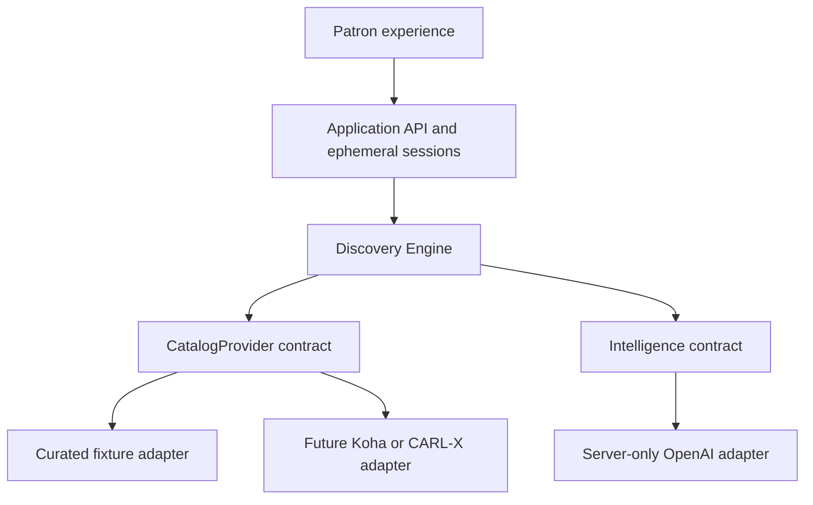

# Shelf architecture

Status: engine foundation and visual demo implemented, including an independent HTTP catalog simulator. Real ILS integration, enrichment and final patron UX validation remain future milestones. This document supersedes the earlier prototype architecture summary.

## Boundaries

This is one Next.js application, not a set of microservices. The engine is transport-independent TypeScript. `lib/application/discovery-service.ts` is the composition root: it selects configured adapters and owns the session lifecycle. API routes validate transport input and call application services. React imports public types and non-secret branch configuration, not the engine, providers, or model clients. Automated import-boundary tests enforce these distinctions.

The engine receives dependencies explicitly. It has no `process.env`, HTTP calls, model SDKs, or provider imports. Catalog adapters receive bounded field/text/cursor queries and record-reference holdings requests, not a conversation, discovery plan, or model-generated executable code. The AI adapter translates structured contracts to a specific API; code validates its output before using it.

## Public application contracts

`POST /api/chat` remains a compatibility URL, not an architectural chat-to-catalog connection. Its body is `{ message, branch?, action?: "search" | "branch", session?: { id, revision } }`. Messages are nonempty and at most 500 characters; streamed requests are bounded at 8 KB. Branch changes reuse server-owned context. An explicit `similar` action carries `selectedResultId`, which must match a group in the server’s last displayed snapshot. Responses also expose active `preferences` for visible UI controls. `previousQuery` is no longer the context contract.

The response contains display groups (`books`), grounded text, notices, optional clarification, suggested actions, source, effective branch, and an updated session token/revision. Each group includes its selected record ID, retained editions, separate holdings, and evidence. Internal session state is never returned. When a response asks for clarification, the UI preserves its displayed cards and the engine preserves the corresponding snapshot. Engine diagnostics are omitted unless `SHELF_INSPECTOR=1`.

`GET /api/catalog/search?q=...&branch=...` is a stateless conventional-search entry point. It uses the same engine with AI disabled. It does not bypass grounding or return a session.

HTTP 400 means invalid input; 403 rejects a mismatched browser Origin; 409 means a concurrent/stale session revision; 410 means expired context; 413 means oversized body; 503 means unavailable service/capacity. Search responses are `no-store`. This is not a public authentication or anti-abuse system.

## Context and lifecycle

A process-local store holds at most 100 opaque UUID sessions, expiring after 30 minutes idle, with timers removing idle state even when no further requests arrive. State contains a bounded goal, terms, preferences, and the most recent ordered result snapshot—not a transcript. Each update requires the last revision, and an in-flight session is locked. Failed requests release the lock without committing a new discovery state. The browser keeps the token only in component memory; reload starts a fresh experience. Server restart expires sessions.

This store deliberately supports one local application process. Multi-worker Windows hosting will require an approved shared ephemeral store or routing design before deployment. Do not imply persistence or cross-process consistency. A token is access to temporary state, not a patron identity.

## Diagnostics and privacy

The engine trace includes queries, candidates, duplicate decisions, groups, evidence, holdings status, timings, and model status. It is an internal object suitable for tests with synthetic requests. The optional browser inspector omits raw query text and cursors. It is not an authenticated administrator interface. Logs do not store request bodies or upstream responses; errors use generic messages. Do not input patron PII during development. Catalog text and model inputs are untrusted.

Live OpenAI requests send the bounded request/context and selected catalog metadata with `store:false`. This is not a promise about provider retention. Organization review is still required. Model cost and token counts are not currently reported because the adapter does not yet propagate usage; never display fabricated estimates.

## Code audit and deliberate changes

| Earlier shortcut                               | Consequence                                                   | Current disposition                                                                            |
| ---------------------------------------------- | ------------------------------------------------------------- | ---------------------------------------------------------------------------------------------- |
| One `Book` combined metadata and branch counts | Cannot represent editions independently of holdings           | Separate source records, optional work relationships, holdings observations and display groups |
| Deduplication by title/author/year/format      | Could discard distinct IDs and their holdings                 | Pool identical provider-qualified IDs only; group by supplied work relationship                |
| Concatenated `previousQuery`                   | Cannot reliably resolve ordinal references or replace filters | Structured session preferences and displayed-result snapshots                                  |
| Provider received entire `Plan`                | Catalog coupling to engine semantics                          | Narrow field/text/cursor queries                                                               |
| Environment selection in orchestration         | Harder independent testing and backend replacement            | Application composition root                                                                   |
| AI embedded in response helper                 | Difficult to change providers or roles                        | `Intelligence` port; bounded interpretation and evidence assessment                            |
| Availability always after final ranking        | No distinction between preference and strict availability     | Relevance shortlist, then holdings and final edition selection                                 |
| Trace always returned                          | Request context unnecessarily exposed                         | Opt-in diagnostics with request-derived text omitted                                           |

Retained: Next.js, strict TypeScript, loopback scripts, temporary reading lists, usable current UI and test tooling. No wholesale frontend rewrite, invented SOAP abstraction, or new database was introduced.

Remaining liabilities: small fixture catalog; simple English parser and substring retrieval; selection window limits; thin metadata; no production auth/rate control; limited accessibility evaluation; no durable/shared sessions; no enrichment implementation; no live AI or ILS validation. See the roadmap for gates rather than treating these as completed features.

## Verification of this foundation

On Linux with Node 24.19.0: all 34 architecture/engine/API/contract tests, all four production Chromium browser tests, strict TypeScript and the Next.js production build passed. `npm audit` reported zero known vulnerabilities. Browser tests used the installed Chromium via `PLAYWRIGHT_CHROMIUM_EXECUTABLE_PATH=/usr/bin/chromium`.

These results verify the local fixture-backed implementation. They do not verify live OpenAI calls, Koha, CARL•X mappings, macOS/Windows execution, complete accessibility compliance or library recommendation quality. No public deployment or patron-system interaction occurred.

## Complete demo additions

`npm run demo` starts an independent loopback catalog simulator plus Shelf. `http-demo` is a separately validated transport adapter; failures do not silently fall back to embedded fixtures. The simulator persists synthetic stock overrides, has no HTTP mutation endpoint, and is not a Koha/CARL•X implementation. The visual client supports explicit similarity, comparison, format/availability controls, edition disclosure, temporary lists and discovery trails. Named-title similarity now verifies a seed through catalog retrieval before exploring its subjects.

The optional private-demo proxy protects pages and APIs with a server-only shared reviewer password. The container defaults to private access, fails closed without sufficient configuration, and exposes only the app port. Hosting requires HTTPS and one persistent Node replica because sessions remain process-local. This is not patron authentication, individual invitation management or a public production deployment.
